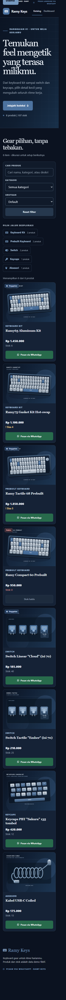

# Catatan Ramy Keys

## URL

- **GitHub:** https://github.com/ravabasya06/ramy-keys
- **Aplikasi publik:** Belum tersedia. Belum ditemukan URL live atau konfigurasi deployment pada workspace.
- **Aplikasi lokal:** http://localhost:5173/ saat `npm run dev` sedang berjalan. Ini bukan URL publik.

## Screenshot

Screenshot full-page katalog dari aplikasi lokal, lebar 360 px:

File: [screenshot-katalog.png](./screenshot-katalog.png)

## Kendala dan batasan

- Aplikasi belum dideploy, sehingga belum ada URL publik untuk diperiksa.
- Proyek masih berupa frontend statis. Dashboard demo tidak memiliki autentikasi/backend dan menyimpan perubahan hanya di `localStorage` browser setempat.
- Data produk bersifat fiktif dan nomor WhatsApp bawaan adalah nomor dummy; keduanya perlu diganti sebelum penggunaan nyata.
- Tidak ada kegagalan test atau build yang teramati pada verifikasi ini.

## Hasil test

Dijalankan pada 19 November 2026:

- `npm test` — **LULUS**, 2 file test, 38 test.
- `npm run build` — **LULUS**, Vite 8.3.8 menghasilkan build di `dist/`.

## Perbaikan prioritas

1. **Sebelum rilis:** deploy build statis dan catat URL aplikasi publik yang benar.
2. **Sebelum menerima pesanan:** ganti nomor WhatsApp dummy dan data/gambar/stok produk fiktif dengan data yang telah dikonfirmasi.
3. **Sebelum mengelola produk sungguhan:** pindahkan penyimpanan ke backend/database dan tambahkan autentikasi serta kontrol akses di server. Dashboard saat ini bukan batas keamanan.
4. **Setelah deployment:** lakukan smoke test pada URL publik, termasuk gambar, pemesanan WhatsApp, dan perilaku penyimpanan browser.
